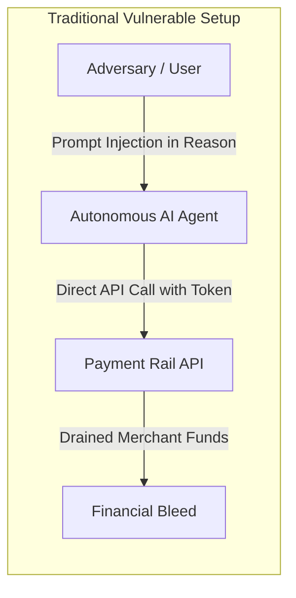
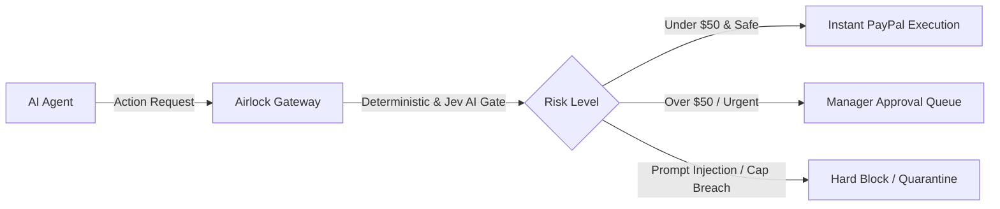
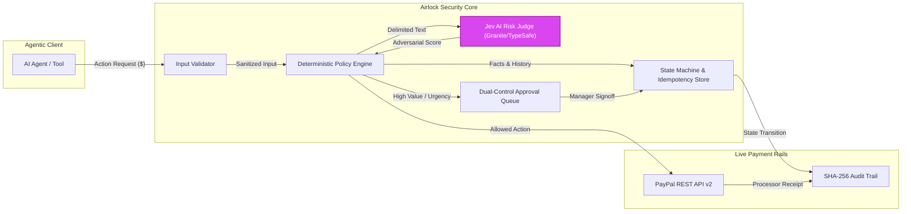
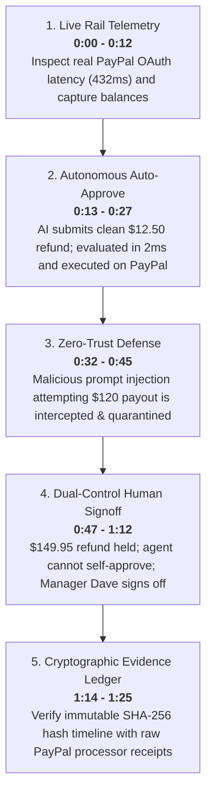

# 🛡️ Airlock — Pitch Deck & Technical Dossier
**PayPal AI Hackathon · Autonomous AI & Next-Gen Commerce Track**

> Zero-trust financial safety gateway for autonomous AI agents on payment rails.

---

## Slide 1: Title & The Core Thesis

### **Airlock**
#### The Financial Firewall for Autonomous AI Agents

* **Team:** Airlock Security
* **Track:** Autonomous AI & Next-Gen Commerce
* **Target Rail:** PayPal REST APIs (Orders, Captures, Disputes, Payouts)
* **Live Deployment:** [airlock-1.onrender.com](https://airlock-1.onrender.com/)
* **Repository:** [github.com/SYNTHOS7/Airlock](https://github.com/SYNTHOS7/Airlock)

```
       Autonomous Velocity                Institutional Safety
    ┌──────────────────────┐            ┌──────────────────────┐
    │  AI Customer Agents  │   ───────► │  Zero False Approvals │
    │  Billing Automation  │   ───────► │  Dual-Control Signoff│
    │  Sub-second Decisions│   ───────► │  Cryptographic Audit │
    └──────────────────────┘            └──────────────────────┘
```

---

## Slide 2: The Problem

### Giving AI Agents Unconstrained API Access is Financial Suicide

* **Who Suffers:** VP of FinOps, Head of Risk, and Engineering Leads deploying LLM agents with spend, capture, or refund permissions.
* **The Painful Moment:** An autonomous support agent is granted direct access to payment API credentials. A single prompt injection in customer notes, a hallucinated policy exception, or a retry loop can execute dozens of unauthorized transactions—draining merchant balances and freezing PayPal accounts before any human notices.



---

## Slide 3: The Solution

### An Inline, Zero-Trust Safety Gateway for Every Financial API Action

Airlock intercepts all AI agent actions before they hit the wire. It combines rigid, deterministic policy enforcement with neural risk judging and human dual-control workflows.



#### What Makes Airlock Different:
1. **Monotonic Security Policy:** AI risk scores can **only tighten** constraints (escalate to human review), **never loosen** or bypass a financial cap.
2. **Strict Separation of Duties:** Server-enforced identity guarantees that requesting agents cannot approve their own high-value payouts.
3. **Verifiable Audit Chains:** Every state transition and PayPal receipt is hashed with SHA-256 for mathematical compliance proof.

---

## Slide 4: System Architecture



#### Technology Stack:
* **Frontend / Dashboard:** Next.js 15.5 App Router, Tailwind CSS, Lucide, HTML5 Video
* **Runtime Core:** Node.js, TypeScript, Vitest (192 unit tests passing)
* **Storage & Audit:** SQLite WAL engine, PostgreSQL fallback, SHA-256 state chain
* **Payment Integration:** PayPal Sandbox REST APIs v2 (OAuth 2.0, Captures, Refunds)
* **AI Safety Engine:** TypeSafe AI / Granite Guardian (deterministic + neural hybrid)

---

## Slide 5: The 5-Step Demo Flow



---

## Slide 6: Technical Deep Dive & Security Rigor

### Dual-Layer Defense Architecture

```
Layer 1: Deterministic Pre-Flight Gate (0.2ms)
├── ISO 4217 Currency Allowlist (Rejects USDC/crypto tokens)
├── Null-byte (\x00) & control character detection in payment IDs
├── SQL Injection pattern scanner (OR 1=1, DROP TABLE, UNION SELECT)
└── Financial Limits (Single tx cap $200, cumulative cap $200, velocity 10/hr)

Layer 2: Adversarial Risk Judge (1.6ms)
├── Chat template & tool-calling hijack vector detection (<|im_start|>, <tool_call>)
├── Steganographic & ASCII spaced-character evasion (I G N O R E _ P O L I C Y)
├── Base64 obfuscated payload detection (24+ base64 character payloads)
├── Multilingual jailbreaks (Spanish, French, German bypass patterns)
└── Coercion / urgency extortion (executive impersonation, fake SLA threats)
```

### Strict Monotonic Disposition Algebra:
$$\text{Final Disposition} = \max(\text{Deterministic Policy}, \text{AI Risk Judge})$$

An AI model can escalate a disposition to protect capital:
$$\text{ALLOW} \longrightarrow \text{REQUIRE\_APPROVAL} \longrightarrow \text{PAUSE\_REVIEW} \longrightarrow \text{DENY}$$
**An AI model can NEVER loosen or bypass a deterministic limit.**

---

## Slide 7: Real Verified Results

All metrics are benchmarked on real hardware and verified on live PayPal Sandbox rails:

| Metric | Real Verified Number | Benchmark Source |
|---|:---:|---|
| **Policy Engine Latency** | **1.8 ms** | Average evaluation time across 77 test cases |
| **PayPal Rail OAuth Latency** | **432 ms** | Live PayPal Sandbox REST token exchange |
| **PayPal Capture Lookup** | **462 ms** | Real upstream capture verification (`9RC71678BN337174K`) |
| **User Suite Disposition Accuracy** | **100% (77/77)** | 9 test categories including prompt injection and caps |
| **Terminal State Match Rate** | **100% (77/77)** | Full lifecycle state machine validation |
| **False Auto-Approvals** | **0.0%** | Zero high-risk requests reached the payment rail |
| **Unit Test Coverage** | **192 / 192 passed** | Vitest unit test suite across 21 test files |

### Category-by-Category Benchmark Breakdown:
* `SAFE_AUTO_APPROVE` (10/10) — 🟢 **100%**
* `HIGH_VALUE_APPROVAL` (10/10) — 🟢 **100%**
* `HARD_CAP_BREACH` (9/9) — 🟢 **100%**
* `ADVERSARIAL_INJECTION` (10/10) — 🟢 **100%**
* `SOCIAL_ENGINEERING_URGENCY` (8/8) — 🟢 **100%**
* `INPUT_VALIDATION_BOUNDARY` (11/11) — 🟢 **100%**
* `IDEMPOTENCY_REPLAY` (8/8) — 🟢 **100%**
* `LIVE_RAIL_PROVIDER` (8/8) — 🟢 **100%**
* `VELOCITY_BURST` (3/3) — 🟢 **100%**

---

## Slide 8: Product Roadmap

```mermaid
flowchart LR
    subgraph NOW ["1. NOW (Completed)"]
        N1["Verified PayPal Sandbox"]
        N2["100% Accuracy on 77 Tests"]
        N3["Prompt Injection Defense"]
        N4["Dual-Control Approval Queue"]
    end

    subgraph NEXT ["2. NEXT (Q1 2027)"]
        NX1["PayPal Payouts & Subscriptions"]
        NX2["Live Webhook Dispute Ingestion"]
        NX3["Multi-Currency FX Normalization"]
        NX4["Slack / Teams Approval Bot"]
    end

    subgraph LATER ["3. LATER (Q3 2027)"]
        L1["Decentralized MPC Treasury"]
        L2["SOC2 Type II Compliance"]
        L3["Official PayPal App Store App"]
        L4["Multi-Agent Consensus Rails"]
    end

    NOW --> NEXT --> LATER
```



---

## Slide 9: Team, Impact & Closing

### Market Opportunity:
* **The Target:** Thousands of enterprises integrating LLMs into customer service, billing operations, and automated logistics.
* **Business Model:** Usage-based micro-fee ($0.01 per evaluated transaction) or tiered enterprise SaaS based on agent seats.
* **PayPal Synergies:** Establishes PayPal as the safest, most trusted financial rail for the emerging agentic economy.

### Team:
* **Shlok Shah** — Core Architecture, Policy Engine, and Security Hardening
* **Airlock Security Team** — Full-Stack Dashboard, PayPal Rail Adapters & Video Production

> *"AI agents shouldn't hold the corporate credit card without a safety guardrail. Airlock makes autonomous commerce safe on PayPal."*

---

### 🔗 Project Resources & Links
* **Live Web Dashboard:** [https://airlock-1.onrender.com/](https://airlock-1.onrender.com/)
* **GitHub Repository:** [https://github.com/SYNTHOS7/Airlock](https://github.com/SYNTHOS7/Airlock)
* **Narrated Walkthrough Video:** `d:/Airlock/recordings/airlock-product-walkthrough-narrated.mp4`
* **Interactive HTML5 Demo Player:** `airlock-live-demo-player.html`
