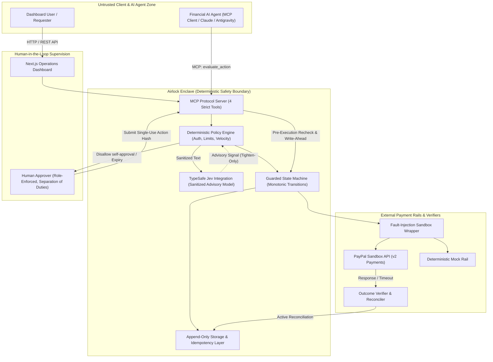
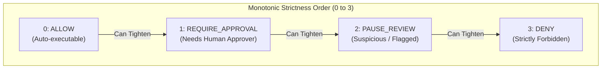

# Airlock Architecture & Data Flow

> **Tagline:** Nothing reaches the payment rail until it's checked, approved, and verified.

Airlock is an auditable safety and outcome-verification middleware layer positioned between financial AI agents and real-world payment rails (PayPal Sandbox and Deterministic Mock).

---

## 1. High-Level Architecture & Trust Boundaries



---

## 2. The 10-Step Airlock Request Lifecycle

```mermaid
sequenceDiagram
    autonumber
    actor Agent as Financial AI Agent
    participant MCP as Airlock MCP Server
    participant DB as Write-Ahead Storage
    participant Policy as Policy Engine & Jev
    actor Human as Human Approver
    participant Rail as Payment Rail (PayPal)
    participant Verifier as Outcome Verifier

    Agent->>MCP: 1. evaluate_action(request_id, payment_id, amount, reason)
    MCP->>DB: 2. Intake with Idempotency Key (IDEMP-001, IDEMP-002)
    MCP->>Policy: 3. Load facts & evaluate (AUTH, LIMITS, VELOCITY, Jev)
    Policy-->>MCP: 4. Disposition (ALLOW / REQUIRE_APPROVAL / PAUSE_REVIEW / DENY)
    
    alt Needs Human Approval
        MCP->>DB: 5a. Generate SHA-256 Action Hash & bind approval record
        Human->>MCP: 5b. Grant approval (APPROVAL-002: separation of duties enforced)
    end

    MCP->>Policy: 6. Pre-Execution Recheck (Fresh capture balance immediately before dispatch)
    MCP->>DB: 7. Atomic Consume Approval & Write-Ahead State = EXECUTING
    
    alt Normal Execution
        MCP->>Rail: 8a. Dispatch refund with idempotent PayPal-Request-Id
        Rail-->>MCP: 8b. Status = COMPLETED
        MCP->>DB: 8c. Record provider_response evidence; State = SUCCEEDED
    else Network Timeout / Dropped Response (Fault Injected)
        MCP->>Rail: 9a. Dispatch refund (rail completes, network drops response)
        Rail--xMCP: 9b. Timeout error
        MCP->>DB: 9c. Record provider_timeout; State = OUTCOME_UNKNOWN (NEVER FAILED)
        Agent->>MCP: 9d. Retry blocked by UNCERTAIN-001; invokes verify_outcome
        MCP->>Verifier: 10a. Active reconciliation (same-key replay & capture balance)
        Verifier->>Rail: 10b. Same-key lookup (returns existing refund without duplicate debit)
        Verifier->>DB: 10c. Record reconciliation evidence; State = SUCCEEDED
    end
```

---

## 3. Guarded Operation State Machine

All transitions are strictly validated by `canTransition()` in `@airlock/contracts`. Any illegal leap throws `IllegalStateTransitionError`.

```mermaid
stateDiagram-v2
    [*] --> RECEIVED
    RECEIVED --> VALIDATING: Begin schema check
    VALIDATING --> EVALUATING: Facts loaded
    VALIDATING --> DENIED: Schema / auth invalid

    EVALUATING --> READY: Policy = ALLOW
    EVALUATING --> AWAITING_APPROVAL: Policy = REQUIRE_APPROVAL
    EVALUATING --> NEEDS_REVIEW: Jev / Policy = PAUSE_REVIEW
    EVALUATING --> DENIED: Policy = DENY

    AWAITING_APPROVAL --> READY: Approved by Human Approver
    AWAITING_APPROVAL --> DENIED: Rejected or Expired

    READY --> EXECUTING: Pre-check passed; Write-Ahead Intent Persisted
    READY --> DENIED: Pre-check failed (balance drained)

    EXECUTING --> SUCCEEDED: Provider returned COMPLETED
    EXECUTING --> FAILED: Provider returned DECLINED
    EXECUTING --> OUTCOME_UNKNOWN: Network timeout / connection dropped

    OUTCOME_UNKNOWN --> VERIFYING: Active reconciliation initiated
    VERIFYING --> SUCCEEDED: Provider proved refund exists
    VERIFYING --> FAILED: Provider proved refund never executed
    VERIFYING --> NEEDS_REVIEW: Inconclusive / balance mismatch (MISMATCH-001)

    SUCCEEDED --> [*]
    FAILED --> [*]
    DENIED --> [*]
    NEEDS_REVIEW --> [*]
```

---

## 4. Monotonic Tighten-Only Strictness Hierarchy

AI models are non-authoritative advisors. They can only **tighten** an outcome toward caution, never loosen or authorize it:

$$\text{ALLOW} \; (0) < \text{REQUIRE\_APPROVAL} \; (1) < \text{PAUSE\_REVIEW} \; (2) < \text{DENY} \; (3)$$

$$\text{Final Disposition} = \max(\text{Policy Disposition}, \; \text{Jev Disposition})$$



### Safety Guarantees
- If deterministic rules say `DENY`, an advisory model outputting `proceed` is strictly ignored; disposition remains `DENY`.
- If deterministic rules say `ALLOW`, an advisory model outputting `injection_suspected` tightens disposition to `PAUSE_REVIEW`.
- If the advisory service is offline or unreachable, the system fails closed by tightening `ALLOW` to `REQUIRE_APPROVAL` (Fail-Safe Default).

